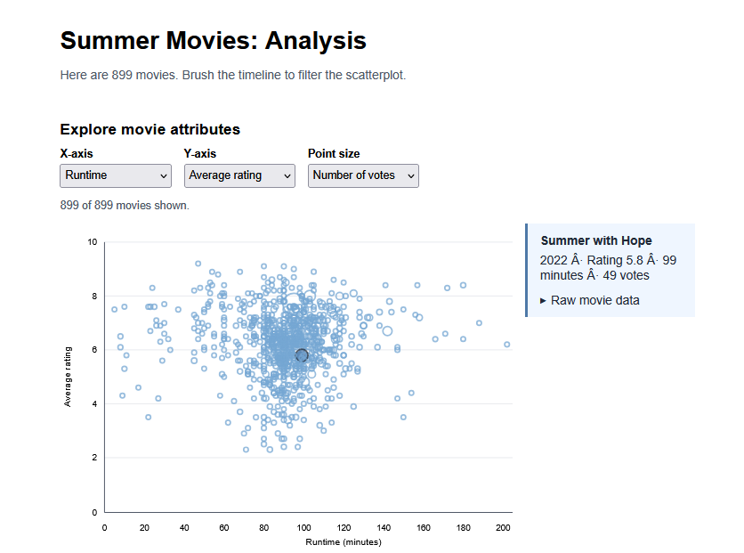
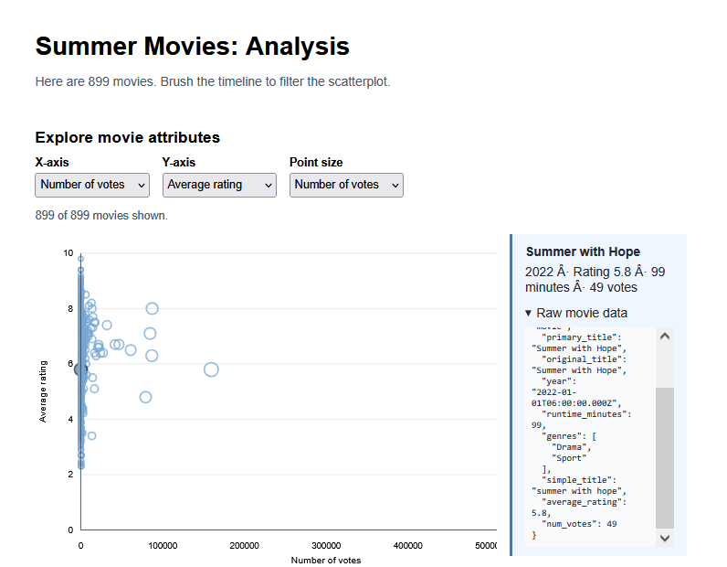
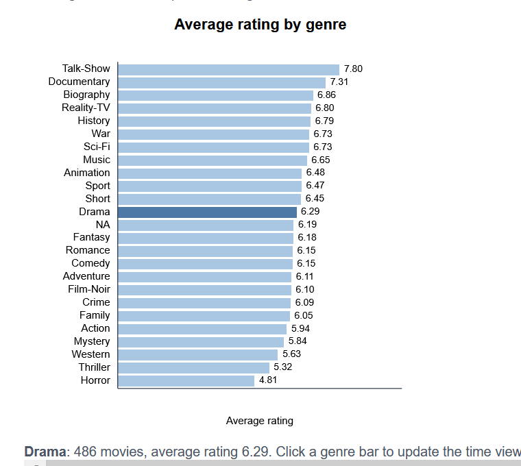
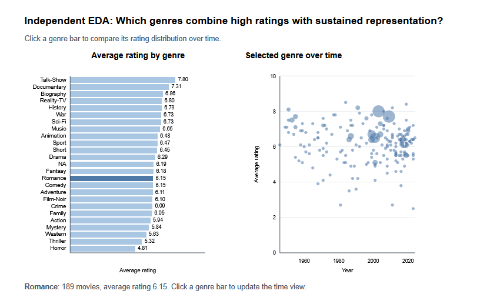
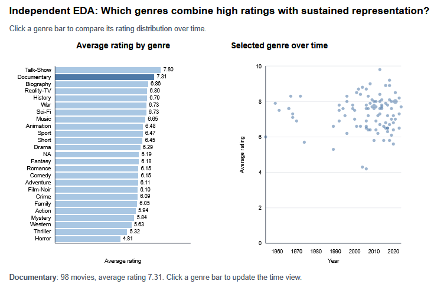
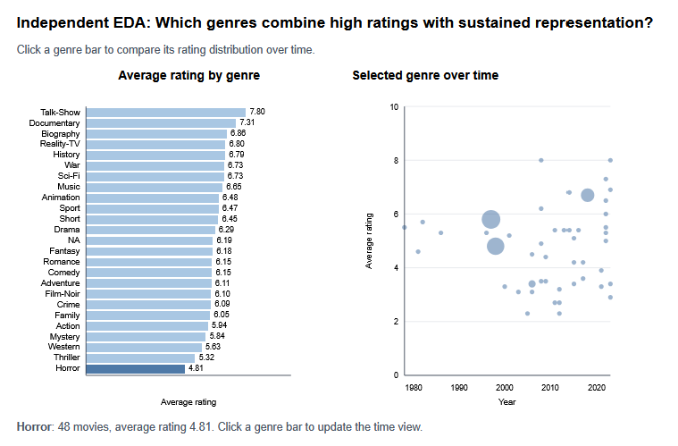

# Assignment 2: Summer Movie Analysis

## Submission Information

- **Demo URL:** `https://john-che-web.github.io/my-vis-5609/A2`
- **GitHub repository:** `https://github.com/john-che-web/my-vis-5609`

## Dataset

My visualization uses the provided `summer_movies.csv` dataset containing 899 summer movies. The dataset includes release year, runtime, genres, audience rating, vote count, title information, and identifiers. Some records contain missing numeric values. These records remain part of the dataset, while visual channels that require numeric values skip the missing values rather than treating them as zero.

## Reflection

### Why is scatterplot opacity set to 0.5?

I think the scatterplot uses opacity `0.5` so overlapping points remain visible. When many movies share similar values, partially transparent circles can blend together and communicate the density of observations. Areas with many overlapping points appear darker, while isolated observations remain lighter and easier to distinguish.

If every point had opacity `1`, points drawn later would completely cover points drawn earlier. Dense regions would hide observations, making it difficult to tell whether a cluster contains a few movies or many movies. Full opacity would therefore reduce the usefulness of the scatterplot for identifying concentration, overlap, and outliers.

### Which attributes should be removed from the dropdown channels?

The dropdowns should not treat text fields and identifiers as quantitative visual channels. The following attributes should be removed from x-axis, y-axis, and point-size selections:

- `primary_title`
- `original_title`
- `simple_title`
- `tconst`
- `genres`

These fields either contain long text, categorical arrays, or identifiers. Mapping them to a numeric position or size produces encodings that do not communicate a meaningful quantitative relationship. `title_type` is also better treated as a categorical filter or grouping variable than as a numeric channel.

Appropriate quantitative channels include `year`, `runtime_minutes`, `average_rating`, and
num_votes`, provided missing values are handled explicitly.

## Guided Exploratory Data Analysis

### Question

**Which factors appear to influence the ratings of summer movies?**

Before using the visualization, I proposed three possible factors:

1. Runtime
2. Number of votes, as a proxy for popularity or audience reach
3. Genre

The dashboard was used to compare these factors with `average_rating`.

### Factor 1: Runtime

For this view, I set the x-axis to `runtime_minutes`, the y-axis to `average_rating`, and point size to
num_votes`. Point size provides additional context about popularity while the x- and y-positions show the runtime-rating relationship.

The relationship between runtime and rating is very weak. The Pearson correlation is approximately `-0.008`, which is effectively zero for this exploratory analysis. The points do not form a strong upward or downward pattern. This suggests that longer movies are not consistently rated higher or lower than shorter movies in this dataset.

### Factor 2: Number of Votes

For this view, I set the x-axis to
num_votes`, the y-axis to `average_rating`, and point size to
num_votes` or another numeric attribute. The x-position shows popularity directly, while point size helps emphasize high-vote movies.

The relationship between vote count and rating is also very weak. The Pearson correlation is approximately `+0.048`. There is a slight positive tendency, but it is not strong enough to conclude that popularity meaningfully predicts rating. The distribution is also highly uneven because a small number of movies have many more votes than most movies.

### Factor 3: Genre

Genre shows the clearest differences in average rating. The genre analysis aggregates each movie into every genre listed for that movie and compares average ratings across genres.

Several genre groups have noticeably different average ratings. For example, Documentary movies have an average rating of approximately `7.31`, while Horror movies have an average rating of approximately `4.81`. Music movies average approximately `6.65`, and Drama movies average approximately `6.29`.

Genre therefore appears to be the strongest of the three proposed factors. This result should be interpreted as an association rather than proof that genre causes a particular rating. Differences may also reflect audience expectations, sample size, time period, or other characteristics of the movies.

### Guided EDA Conclusion

Runtime and vote count show weak linear relationships with rating in this dataset. Genre shows larger differences between groups, making it the most promising factor for explaining variation in summer movie ratings. The analysis demonstrates why linked visualizations are useful: the scatterplot reveals continuous relationships and outliers, while the genre comparison reveals group-level differences.

## Independent Exploratory Data Analysis

### New Question

**Which genres combine high audience ratings with sustained representation over time?**

This question is different from the guided question because it focuses on the combination of genre quality and genre presence over time rather than testing individual factors against rating alone.

### Visualization and Interaction

The independent analysis contains two linked views:

1. A horizontal bar chart showing the average rating for each genre.
2. A scatterplot showing rating over release year for the currently selected genre.

Clicking a genre bar updates the time-based scatterplot. The selected-genre summary reports the number of movies and the average rating for that genre. Point size uses vote count when it is available, providing additional audience-reach context.

### Independent EDA Analysis

The linked views make it possible to compare both group-level rating and temporal distribution. Documentary has a high average rating and can be inspected for whether that rating is concentrated in a particular period or appears across many years. Horror has a lower average rating, allowing a contrasting view of its rating distribution over time. The number of movies in each genre is important when interpreting the averages: genres with very few movies should not be compared with the same confidence as large groups such as Drama or Comedy.

The time view also helps distinguish a consistently represented genre from a genre concentrated in only a few years. A genre with high ratings but very few movies or a narrow time span may be less representative of the overall summer-movie dataset than a genre with comparable ratings across a sustained period.

### Independent EDA Conclusion

The independent visualization supports comparison of rating level, sample size, and time coverage in one coordinated view. Genre is not equally represented across the dataset, and the highest-rated genre is not necessarily the most common. Linking the views makes those differences visible and prevents interpreting an average rating without considering when and how often that genre appears.
